# TrackMyBoardGames Build Plan

## Goal

Build a personal board-game library and play tracker. Each user manages a private collection, records plays, and can print a QR label for a game. Scanning a label should make recording a play quick; reports summarize what has been played and when.

## Starting Point and Stack

- `backend/`: Spring Boot REST API, Java, Spring Data JPA, PostgreSQL.
- `frontend/`: React + TypeScript + Vite.
- The projects will live under a single repo. 
- The repository contains generated Spring Boot and React/Vite starter scaffolds. The React app currently shows its starter page; the app’s features, backend API routes, and frontend-to-backend integration are still to be built.
- This doc will be updated reguarly as milestones are completed.

## Milestones

| Version | Focus | Completion criteria |
| --- | --- | --- |
| **0.1** | Reliable foundation | Setup backend Java API and a frontend React environment (utilizing Vite); confirm the app starts locally against PostgreSQL; add database migrations (Flyway) capability before defining persistent domain tables. |
| **0.2** | Accounts and authentication | Users can register, sign in, and sign out through Auth0 Universal Login; Auth0 stores and verifies credentials, which the app never stores. Spring validates Auth0 JWTs (issuer, audience, signature, and required API scopes) on protected endpoints. Test unauthenticated requests (401), missing permissions (403), and authenticated access with mock JWTs; manually verify a real Auth0 token. |
| **0.3** | Personal game library | Authenticated users can create, view, edit, delete, search, and list their own board games. A game has a name and useful optional details such as player count, play time, and notes. Verify users cannot read or change another user's games. |
| **0.4** | Play history | Users can record, view, edit, and delete a play for one of their games. Store at least the played date; keep duration, players, and notes optional. Show each game's play count and most recent play. |
| **0.5** | QR labels & Camera and photo scanning | Generate a unique QR code per game and provide a print-friendly label. Scanning resolves only games the signed-in user is authorized to access. Allow a code to be revoked and regenerated.   On a scan screen, users can scan a QR code with a supported device's camera or select a photo. A successful scan identifies the game and asks for confirmation before recording a play. Handle denied camera access, invalid codes, and unknown or revoked codes with supported testing. |
| **0.6** | UIEnhancementOne - mobile UI pass | Improve mobile navigation with a bottom dock and reorganized add/actions menu; simplify the mobile header; improve game-cover and play-history presentation; contain wide-table scrolling and prevent page-level horizontal overflow on narrow screens. Preserve desktop navigation and core collection workflows. |
| **0.7** | Cloud connectivity and hosting configuration | Complete the hosting, connectivity, certificate automation, and verification criteria listed below. |
| **0.8** | Experience and backend improvements | **UIEnhancementTwo:** Focus on improving the user interface and user experience (UI/UX), including mobile usability, enhancements, and bug fixes.  **BackendEnhancementOne:** Focus on improving general backend processes, including authentication and account handling. |
| **0.9** | Library insights | Add useful visual summaries such as plays over time, most/least played games, and games not played recently. Support date filters. Keep metrics consistent with the play-history records. |
| **1.0** | Stable initial release | Complete responsive and accessible core workflows; tests show useful validation and error states; verify authorization, migrations, and backup/restore procedures; document configuration and deployment. Tag the verified release `v1.0.0`. |

**QR scope decision:** Start with QR codes rather than inventing a new barcode format as a baseline. R&D needed to determine best solution for scanning mechanism.

### 0.7 completion criteria - Cloud connectivity and hosting configuration

- **Hosting:** Support an Amplify-hosted React frontend and a Java SE Beanstalk backend connected to the Neon development PostgreSQL database.
- **Connectivity and authentication:** Configure environment-based API URLs, JDBC credentials, CORS, and Auth0 settings.
- **Database schema:** Apply Flyway migrations to the hosted database.
- **Custom domain and HTTPS:** Add Route 53 custom-domain routing and single-instance Let's Encrypt HTTPS with scoped IAM permissions.
- **Repeatable deployment:** Automate certificate renewal and package the JAR plus configuration in a repeatable deployment ZIP.
- **Verification:** Verify trusted HTTPS, renewal, and authenticated frontend-to-backend workflows before considering the milestone complete.

- See [the hosting flow overview](APP-HOSTING-FLOW.md) for the architecture and service responsibilities, and [the deployment guide](AWS-Amplify-Beanstalk-Deployment.md) for build, configuration, and deployment steps.

## Build Loop

For each milestone, split work into small vertical slices that include the UI, API, persistence, and tests needed for that slice:

1. Create an issue or checklist item with observable acceptance criteria.
2. Create a short-lived feature branch from `main`.
3. Implement and test the functionality; keep secrets and sensitive information out of source control.
4. Review the diff and run relevant checks before merging into `main`.
5. When all criteria for a milestone pass, update the plan and tag the commit (for example, `v0.3.0`).

Keep `main` buildable. Use branches for features. Example branch names: `feature/registration`, `feature/game-library`, `feature/play-history`, and `feature/qr-labels`. The feature branches will collect into milestone release branches i.e. `0.1-release`. After a stable milestone release the branch will migrate into `main`. A milestone tag will be created so that the milestone branch can then be deleted.

## Roadmap

```mermaid
flowchart LR
    V01["0.1 Foundation"] --> V02["0.2 Accounts"]
    V02 --> V03["0.3 Game library"]
    V03 --> V04["0.4 Play history"]
    V04 --> V05["0.5 QR labels & Scanning"]
    V05 --> V06["0.6 UIEnhancementOne"]
    V06 --> V07["0.7 Cloud connectivity and hosting"]
    V07 --> V08["0.8 Experience and backend improvements"]
    V08 --> V09["0.9 Insights"]
    V09 --> V10["1.0 Stable release"]
```

## Initial Technical Guardrails

- Use database migrations to evolve the schema.
- Keep credentials and sensitive data in environment variables or local untracked configuration.
- Use HTTPS in deployed environments; browser camera access requires a secure context (localhost is allowed for local development).
- Defer optional features such as social sharing, multiple collections, etc. until the core workflow is solid.
