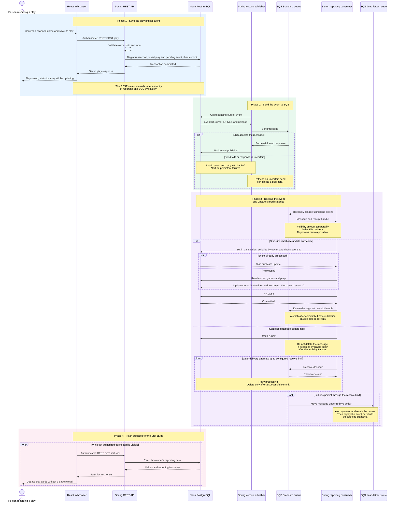

# SQS Statistics - Sequence View

**Status:** Proposed design, not implemented behavior.

This view explains **what happens over time** when a play is recorded. The same design applies to game/play edits and deletes. See [the architecture view](SQS-ARCHITECTURE.md) for hosting boundaries.

## How to read the boxes

The colored backgrounds separate four phases: **blue = save**, **green = send**, **purple = process**, and **pink = display**. Colors are translucent so the viewer's light/dark theme can remain readable.

The dotted-outline boxes describe conditions or repetition:

- **alt / else:** alternative outcomes, like `if / else` in code. Only the applicable branch runs for that attempt, not both.
- **loop:** work that repeats, such as checking for new statistics or retrying delivery.
- **opt:** an optional branch, performed only when its condition is true.
- **end:** closes the corresponding diagram block, not the entire application workflow.

### Normal successful path

1. Save the play and its event.
2. Follow **SQS accepts the message**, then continue below that box.
3. The receiver gets the message and follows **Statistics database update succeeds**.
4. For a first delivery, follow **New event**. For an already-processed duplicate, skip the update.
5. Commit the database work and delete the processed SQS message.
6. The open page fetches the statistics and updates its cards.

**SQS accepting the message is not the end of processing.** It means the queue has accepted the sender's message, not that the receiver has updated the statistics.

The polling loop is independent background activity. Its placement at the bottom explains the eventual display result; it can also run before processing finishes and return the previous values.

### What is the statistics database update?

This is the receiver's work in **Neon**, not the React Stat component or a new hosting container. It reads current games/plays, updates the derived reporting tables used by the four cards, and records that the event was processed.

A **transaction** groups those database changes so they either commit together or roll back together. This is a second transaction, separate from the original transaction that saved the play and outbox event.

React later reads these stored values through the statistics REST endpoint. The UI component displays the values; it does not perform the database transaction.

## Three different milestones

1. **Saved:** the original play and outbox event committed. The person can receive confirmation now.
2. **Processed:** the consumer committed reporting changes. This can happen later.
3. **Displayed:** the browser fetched the new reporting version and rendered it.

These are not one synchronous request. An open page on another device can update through its next poll, as long as it is authorized to view the same collection.

## Why the extra steps matter

| Step | Purpose |
| --- | --- |
| Save play and outbox together | Avoid saving a play with no durable record of the event that must be processed. |
| Mark published after successful SQS response | Avoid discarding an event before the queue accepts it. |
| Deduplicate inside the reporting transaction | Prevent duplicate deliveries from applying the same change twice. |
| Serialize by collection owner | Prevent concurrent consumers from overwriting a newer reporting result with an older one. |
| Delete SQS message after database commit | Keep failed/uncommitted work eligible for redelivery. |
| Dead-letter queue and alerts | Make repeated consumer failures visible and recoverable. |
| Browser polling | Bring updated reporting data into React; queue processing alone cannot repaint another device. |

The diagram abbreviates transaction/claiming details. Implementation must handle worker crashes, expired claims, visibility-timeout extension or bounded processing, malformed messages, duplicate and out-of-order delivery, and retry limits.

## First implementation boundaries

- Keep REST mutation endpoints, ownership checks, and the existing collection count working.
- Build the new four-card panel and its reporting endpoint independently.
- Backfill reporting for existing users before switching to the event-driven read model.
- Show initial loading, errors, and stale/updating status honestly; do not use zero as a fallback for unavailable data.
- Poll only while visible, refresh on return, and use bounded faster checks after local changes. Confirm freshness with an agreed version contract rather than assuming any response is current.
- No live push/SSE, shared-business accounts, payment processing, or chart library is required for this first slice.
- Initial publisher and consumer run within Beanstalk. Amazon SQS hosts only the queue service; Neon stores records and reporting data.
