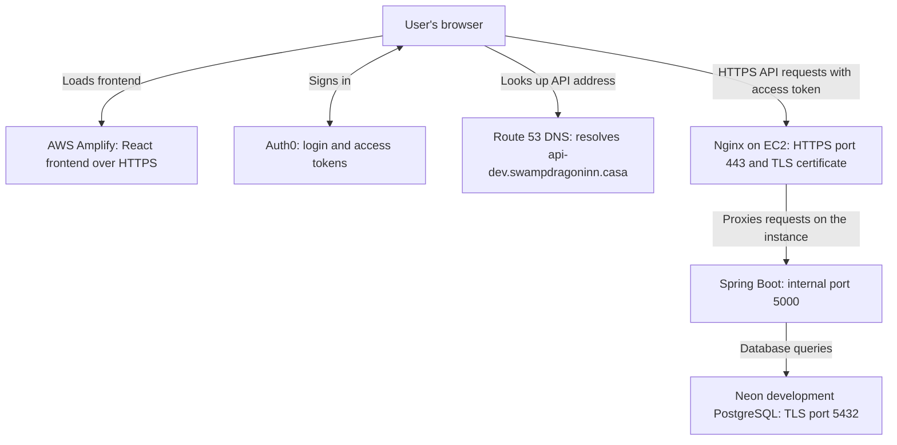

# Bringing TrackMyBoardGames Online

Run command examples from the repository root unless a step says otherwise.

This document explains the high-level architecture and the setup work used to
bring the development app online. For commands and detailed deployment
instructions, see [the deployment guide](AWS-Amplify-Beanstalk-Deployment.md).

## 1. How requests travel



DNS resolves a name to the backend; it does not forward HTTP requests or encrypt
them. Nginx handles browser-facing HTTPS, then forwards requests locally to Java.
There is no load balancer in this setup.

## 2. What each service does

| Component | Responsibility |
|---|---|
| GitHub | Stores the source code; connected branch changes trigger Amplify builds. Backend ZIP uploads remain manual. |
| Amplify | Builds and hosts the React frontend. Its HTTPS does not automatically give the separate backend HTTPS. |
| Auth0 | Signs users in and issues access tokens. Spring validates tokens and enforces API permissions. |
| Elastic Beanstalk | Manages application deployments, platform configuration, health reporting, and the underlying EC2 instance lifecycle. |
| EC2 | The actual Linux server running Nginx, Java, and certificate renewal. Its compute/storage costs remain even without a load balancer. |
| EC2 security group | Network firewall. Public HTTP uses port 80; public HTTPS uses port 443. Java port 5000 stays internal. |
| Route 53 | Registers the domain and hosts DNS records. Registration/renewal and DNS hosting are separate costs. |
| Let's Encrypt and Certbot | Issue a free TLS certificate and automate renewal. Certbot runs on the instance. |
| IAM instance role | Gives the instance limited AWS permissions without putting AWS access keys in source code. |
| Neon | Hosts PostgreSQL. The development branch and database are separate concepts from the Git branch. |

## 3. What we configured

### Frontend

- Built the React app in Amplify from the frontend directory.
- Added SPA rewrites so nested React routes survive direct navigation and refresh.
- Configured the public Auth0 domain, client ID, and API audience.
- Added the Amplify frontend origin to Auth0's callback, logout, and web-origin lists.
- The final API setting is
  `VITE_API_BASE_URL=https://api-dev.swampdragoninn.casa`.
  It needs a frontend rebuild to take effect; it must not contain `/api` or a
  trailing slash.
- Never place database passwords or Auth0 client secrets in `VITE_` variables:
  these variables are embedded in browser code.

### Backend and database

- Created a Java SE Beanstalk environment using Corretto 25.
- Deployed the executable Spring Boot JAR and set `SERVER_PORT=5000`.
- Configured Neon database access with three separate Beanstalk variables:
  `DB_URL`, `DB_USERNAME`, and `DB_PASSWORD`.
- `DB_URL` is a JDBC URL without embedded credentials. Its host is the direct
  Neon endpoint because Flyway also runs during startup.
- Existing Flyway migrations created the schema in Neon. They did not import
  local PostgreSQL game data.
- Preserved Auth0 rather than enabling Neon Auth.
- Set backend `CORS_ALLOWED_ORIGINS` to the actual Amplify frontend origin.
- The instance needs outbound database access on TCP 5432, not an inbound
  database rule or another `SERVER_PORT` setting.

The backend and Neon currently use different AWS regions: Beanstalk is in
`us-west-1`, while Neon is in `us-west-2`. This works over the network, but is not
same-region hosting.

### Domain and DNS

- Registered `swampdragoninn.casa`.
- Created `api-dev.swampdragoninn.casa` as a CNAME pointing to:
  `trackmyboardgames-dev.eba-7rxusur4.us-west-1.elasticbeanstalk.com`.
- Used a hostname rather than hard-coding the EC2 instance IP.
- Verified the custom HTTP health endpoint returned `{"status":"ok"}`.
- The root domain is not automatically connected to Amplify by creating the API
  subdomain. A custom frontend domain would be a separate setup.

### IAM and certificate validation

- Left the Beanstalk service role unchanged.
- Added certificate-validation permissions to the instance role associated with
  the `aws-elasticbeanstalk-ec2-role` instance profile.
- Permitted hosted-zone discovery and checking Route 53 DNS-change status.
- Restricted DNS writes to TXT records named
  `_acme-challenge.api-dev.swampdragoninn.casa` in the selected hosted zone.
- Certbot uses temporary credentials from the instance role, not static access keys.

During issuance and renewal, Certbot creates a temporary validation TXT record.
Let's Encrypt checks that record to prove domain control. Certbot then removes
the validation record. The API's CNAME is not replaced.

## 4. Why the deployment is now a ZIP

The app still runs as a Java JAR. The ZIP is just a delivery container for the
JAR plus the extra infrastructure configuration:

```text
trackmyboardgames-beanstalk.zip
|-- application.jar
|-- Procfile
|-- .ebextensions/
|   `-- https.config
`-- .platform/
    |-- hooks/prebuild/10-https.sh
    |-- confighooks/prebuild/10-https.sh
    |-- nginx/conf.d/https.conf
    `-- scripts/
        |-- setup-https.sh
        `-- certbot-requirements.txt
```

- `Procfile` starts Java.
- `.ebextensions` makes Beanstalk manage the inbound port-443 rule.
- Prebuild hooks install Certbot and obtain the certificate before Nginx loads
  the HTTPS listener. Configuration updates run the same setup.
- Nginx adds HTTPS while retaining the existing HTTP listener.
- A systemd timer checks renewal twice daily, with a randomized delay, and a
  deployment hook reloads Nginx after a successful renewal.
- Certificate private keys stay under `/etc/letsencrypt` on the instance,
  outside the source repository and deployment ZIP.
- On a replacement instance, the setup obtains a certificate again. Repeated
  issuance can hit Let's Encrypt limits; this is not a shared-certificate or
  high-availability design.

Do not upload only the JAR for future deployments: it omits these configuration
files. Do not ZIP the whole backend directory either; the packaging script
selects only deployment files and excludes local credential files.

## 5. Build and deploy from Windows

From the repository root, use Java 25 explicitly to avoid the existing local
`JAVA_HOME` mismatch:

```powershell
$env:JAVA_HOME = 'C:\Program Files\Eclipse Adoptium\jdk-25.0.4.101-hotspot'
$env:Path = "$env:JAVA_HOME\bin;$env:Path"
Set-Location backend
.\mvnw.cmd clean package
if ($LASTEXITCODE -eq 0) {
    .\package-beanstalk.ps1
}
```

The normal Maven command runs tests and requires the database configuration used
by those tests. To reproduce the earlier packaging-only validation, use
`.\mvnw.cmd clean package '-DskipTests'` instead; that builds the app without
running database tests and does not prove runtime connectivity.

Upload `backend/target/trackmyboardgames-beanstalk.zip` in Beanstalk.

Before the first HTTPS deployment:

1. Save `LETSENCRYPT_EMAIL` as a Beanstalk environment variable.
2. Confirm the instance role has the DNS permissions described above.
3. If a port-443 rule was manually created earlier, remove only that manual rule
   immediately before deployment. Otherwise the managed rule can conflict with it.
4. Leave port 80, other existing rules, and the application's environment variables intact.

After deployment:

1. Check Beanstalk health and deployment logs.
2. Verify `https://api-dev.swampdragoninn.casa/api/health` with normal certificate
   validation enabled.
3. Update Amplify's API URL and rebuild the frontend.
4. Test authenticated collection loading and saving from Amplify.
5. Verify the renewal timer and run Certbot's renewal dry run when instance access
   is available. Monitor timer failures; do not rely on certificate-expiry emails.

## 6. Verification boundary

At the time this document was added:

- The backend health endpoint had been verified over HTTP, including the custom domain.
- Neon migrations and earlier database-backed API tests had passed.
- The HTTPS bundle had built successfully; shell syntax and ZIP contents had been checked locally.
- Live certificate issuance, HTTPS operation, renewal, and the final Amplify-to-API
  flow still required verification after uploading the HTTPS bundle.

Domain ownership and IAM permissions alone do not prove HTTPS is working.
