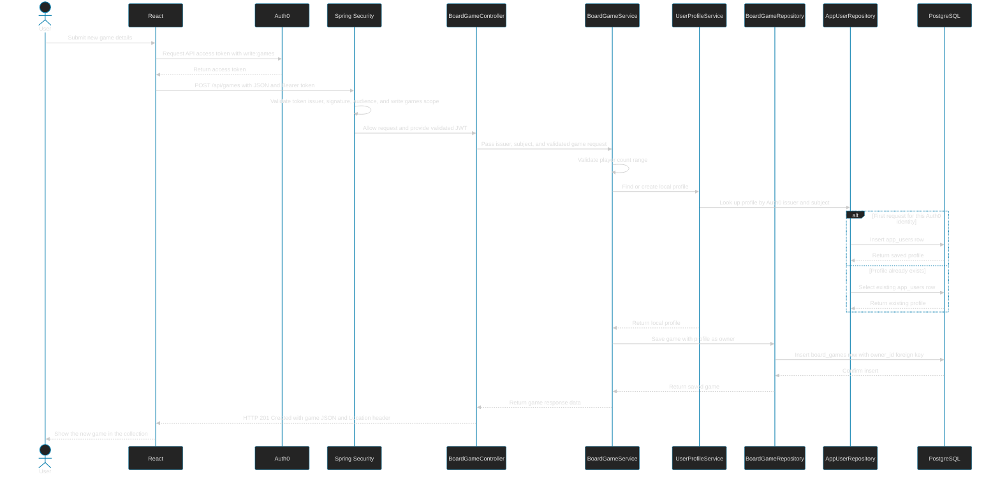

# Board Game Creation Flow

This diagram describes the backend flow for creating a board game. The React collection page does not yet have an Add Game form wired to this endpoint; that is frontend work still to come.

## Return Path

The response does **not** return immediately after the controller calls the service. The controller waits while the service validates the request, finds or creates the local profile, and saves the game. Once the service returns, the controller sends the created-game JSON with HTTP `201 Created`. If any step fails, the request returns an error instead of a successful game response.

The service method is transactional: its database operations commit together if successful, or roll back together if a runtime error occurs.

## Identity and Ownership

Auth0 authenticates the person and supplies a signed token. Spring Security validates that token before the controller runs. The service uses the token issuer and subject to find the corresponding `app_users` row; it does not store the user's Auth0 password. The new game's `owner_id` references that local profile's primary key, and every later game query filters by that owner.
