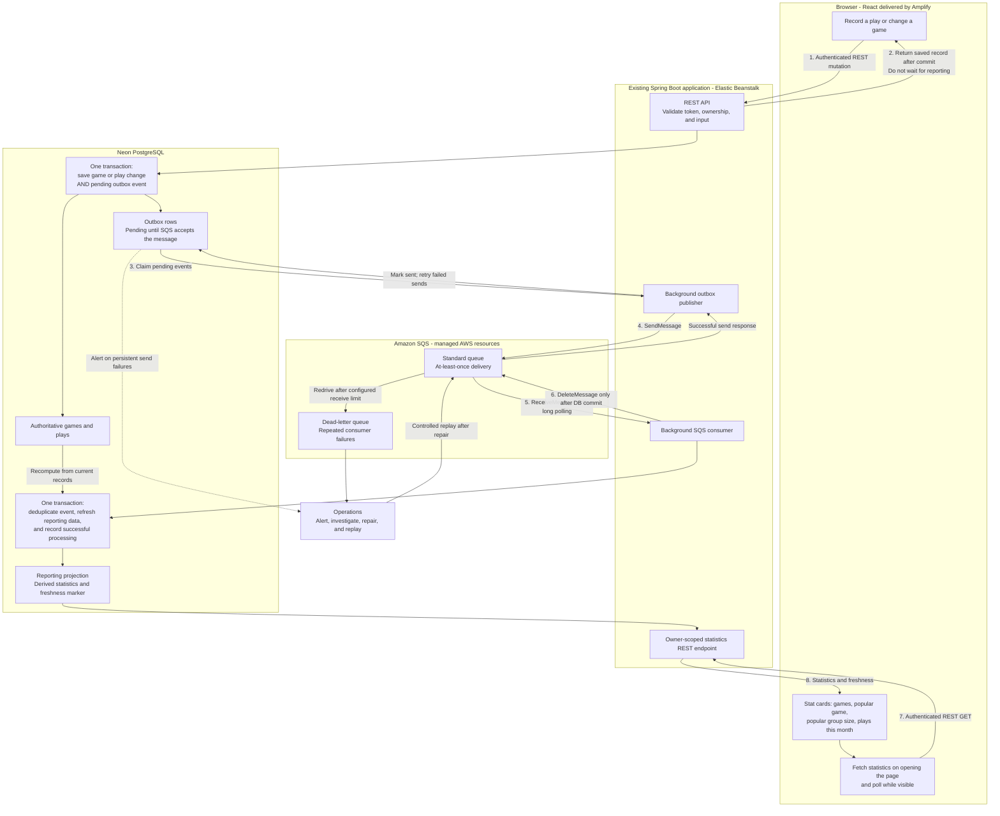

# SQS Statistics - Architecture View

**Deprecated proposal:** SQS was not selected. Kept for historical context; see [the current RabbitMQ statistics architecture](../eda-architecture-statistics-component.md).

**Status:** Proposed design. No queues, workers, or statistics endpoints are deployed by this document.

This view explains **where the pieces run**. For the order of operations, see [the sequence view](SQS-EVENT-FLOW.md).

## Reading the diagram

- **REST is the front door:** React still saves records and reads statistics through authenticated REST calls. The browser never receives SQS credentials.
- **Events connect background work:** the publisher and consumer initially live inside the same Spring Boot application. They are separate responsibilities, not separate deployed projects.
- **SQS is the additional service:** AWS hosts the queue; there is no RabbitMQ/Kafka server for us to maintain. SQS access uses the Beanstalk instance role with least-privilege IAM.
- **Neon remains authoritative:** reporting data is derived and rebuildable. A failed reporting update does not undo a successfully saved play.
- **The old game count remains untouched:** only the new Stat panel reads this reporting endpoint. Paid-tier limits must use authoritative transactional checks, not delayed statistics.

## What the four Stat cards mean

| Card | Definition |
| --- | --- |
| Total Games | Current games in the signed-in user's collection. |
| Most Popular Game | Game with the most recorded play sessions, across all time. |
| Most Popular Group Size | Most frequent recorded player count, excluding missing values. |
| Plays This Month | Sessions with a played-on date in the current calendar month. |

The panel stays visible during add/edit forms. Layout is four cards in one desktop row and a two-by-two grid on mobile.

## Reliability and scope

- Every relevant add/edit/delete must emit an event. Renaming games, changing player counts/dates, and cascading game deletion must be reflected in reporting.
- Standard SQS messages may be duplicated or out of order. Store processed event IDs, serialize reporting updates per owner, and recompute from authoritative records rather than trusting arrival order or blindly adjusting counters.
- A send can succeed just before the publisher crashes. Its retry can produce a duplicate; consumer deduplication handles that.
- Send failures remain in the outbox; they do not reach the SQS dead-letter queue. Consumer failures use visibility-timeout redelivery and eventually the dead-letter queue.
- Configure retry/backoff, alerting, event retention, and cleanup. Bound retries and make failed work visible.
- Backfill existing data and provide a rebuild procedure. Store enough monthly data, or implement a rollover refresh, so a new calendar month works without a new event.
- User timezone, tie-breaking, polling interval, and freshness/version contract remain implementation decisions.
- Polling updates already-open authorized pages eventually, including another device viewing the same collection. SQS does not push into React. Shared shop access is separate scope.
- If Beanstalk is down, processing pauses. Queue retention and outbox retention must cover expected outages; neither replaces database backups.

## Cost and deployment

Keep code in this repository. Deploy React through Amplify and Spring through Beanstalk; add a Standard SQS queue, a dead-letter queue, IAM permissions, and environment configuration separately. No Lambda or new worker deployment is required initially.

SQS charges by requests, including empty receives; use long polling and monitor usage. Database work also affects Neon compute. Verify current [SQS pricing](https://aws.amazon.com/sqs/pricing/) before provisioning; free allowances are not an unlimited-free guarantee.
