# SQS EDA Building Blocks

**Deprecated proposal:** SQS was not selected. Kept for historical context; see [the current RabbitMQ statistics architecture](../eda-architecture-statistics-component.md).

**Proposed design, not yet implemented.** This picture focuses on messaging, not the browser or every database operation.

```mermaid
flowchart LR
    Save["💾 Save-play code<br/>Saves the play AND creates a PlayRecorded event"]
    Outbox[("🗄️ Outbox table in Neon<br/>Stores the event until it can be sent")]
    Sender["📤 Sender / publisher<br/>Reads pending events from the outbox"]
    Queue["📨 Amazon SQS queue<br/>Holds the sent messages"]
    Receiver["📥 Receiver / consumer<br/>Reads a message and performs the follow-up work"]
    Result["📊 Updated statistics in Neon<br/>Ready for the dashboard to request"]

    Save -->|"Same transaction as saving the play"| Outbox
    Outbox -->|"Pending PlayRecorded event"| Sender
    Sender -->|"Send message"| Queue
    Queue -->|"Receive message"| Receiver
    Receiver -->|"Refresh statistics"| Result

    classDef application fill:#dcfce7,stroke:#16a34a,color:#14532d
    classDef database fill:#f3e8ff,stroke:#9333ea,color:#581c87
    classDef messaging fill:#ffedd5,stroke:#ea580c,color:#7c2d12
    classDef result fill:#dbeafe,stroke:#2563eb,color:#172554

    class Save,Sender,Receiver application
    class Outbox database
    class Queue messaging
    class Result result
```

## Event versus outbox versus queue

Think of sending a letter:

| Piece | Analogy | In this app |
| --- | --- | --- |
| Event | The letter describing what happened | `PlayRecorded`, with an event ID, owner ID, and play/game identifiers. |
| Outbox | A tray holding letters not yet sent | A dedicated Neon table, written in the same transaction as the play. |
| Sender | The person mailing the letter | Background Java code that reads pending outbox rows and sends messages. |
| SQS queue | A delivery service holding mail for collection | AWS stores messages until processed/deleted, subject to configured retention. |
| Receiver | The person collecting and acting on the letter | Background Java code that updates reporting data. |

The same event is stored in an outbox row and then serialized into an SQS message. Those are two stages of delivery, not two different business events.

## What the sender watches

**The outbox table, not the play-history table.** Saving a play deliberately creates the event; the sender does not infer it by discovering a new play row. Editing or deleting a record can deliberately create its own event too.

The sender marks the outbox row published only after SQS accepts it. The receiver deletes the SQS message only after its reporting transaction commits. Retries can create duplicate deliveries, so processing must be safe to repeat.

All green boxes initially run in the existing Spring Boot application. Purple/blue stored data lives in Neon, and SQS is the additional managed AWS service. No separate receiver project is required.

React periodically fetches the resulting statistics through REST; it does not read SQS messages. See [the simple overview](SQS-SIMPLE-OVERVIEW.md) for that separate display flow.
