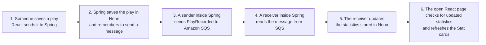
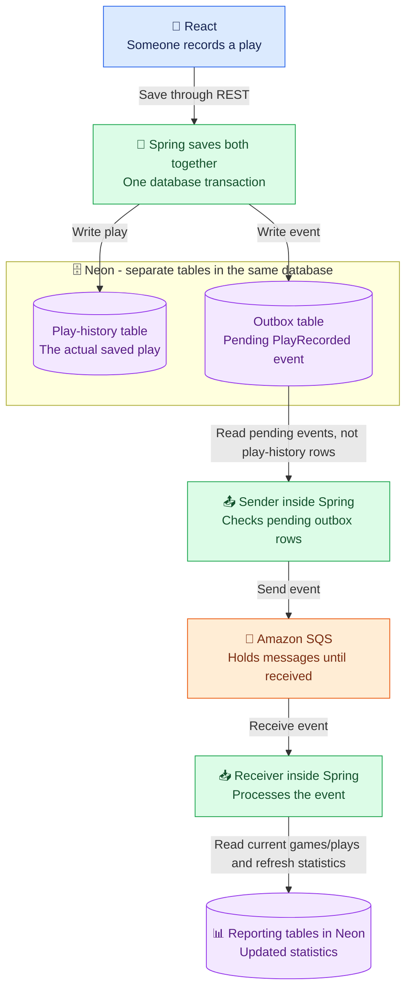
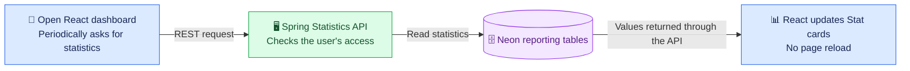

# SQS Statistics - Start Here

**Deprecated proposal:** SQS was not selected. Kept for historical context; see [the current RabbitMQ statistics architecture](../eda-architecture-statistics-component.md).

**Proposed design, not yet implemented.** Read this first diagram from left to right. It shows just one example: someone records a play and an open dashboard updates afterward.

## Icon-style overview

The same idea, split into two pictures so message processing and dashboard requests do not overlap. Arrows describe the flow of data, not every individual request and response.

### A. Save a play and process its event

The sender does **not** scan the play-history table for new records. It checks pending rows in the outbox table. Each row contains an event, such as `PlayRecorded`, with an event ID and the identifiers needed for processing. After SQS accepts a message, the sender marks its outbox row as published.

### B. Show the updated statistics

The dashboard and Stat cards above are the same React page, drawn separately to show the request and result without crossing arrows. The database does not respond directly to the browser; Spring returns the values in its REST response.

**Color key:** blue = browser, green = Spring application code, orange = message queue, purple = database.

Icons are text symbols inside standard Mermaid shapes, not official AWS service icons. Their appearance depends on the Markdown viewer's fonts; no external icon library is needed.

## How this relates to your RabbitMQ experience

| What you used before | Proposed equivalent here |
| --- | --- |
| C# code sends messages | Java code inside Spring sends messages. |
| RabbitMQ carries the messages | Amazon SQS carries the messages. |
| Another project receives messages | Receiver code initially runs inside the same Spring application as the sender. It could be separated later. |
| Receiving project builds a UI from incoming data | Receiver updates stored statistics; React fetches those statistics to display the UI. |

The sender and receiver can be in the same application and still communicate asynchronously through a queue. SQS is a separate managed AWS service, but we do not need another application deployment for the receiver.

## What happens automatically?

- Saving the play triggers the background messaging work.
- An already-open, authorized page checks for updated statistics periodically. The user does not have to reload.
- The cards can briefly show the previous values while processing catches up.
- The final arrow is a simplified dependency, not a direct push from the receiver into React. React checks through a normal API request.

## Plain-language terms

- **REST request:** the browser calls an API endpoint, as it already does today.
- **Mutation:** just a word for adding, editing, or deleting data. Reading data is not a mutation. No special new kind of REST is involved.
- **Event:** a message describing something that happened, such as `PlayRecorded`.
- **Outbox:** a database table holding events waiting to be sent. It is not the event itself.
- **Sender / publisher:** code that sends the event to the queue.
- **Receiver / consumer:** code that reads the event and does the follow-up work.
- **Change a game:** add a game, edit one of its details, or delete it. For example, renaming the most-played game should update its name in the Stat card.

## Why edits and deletes matter too

This diagram only shows a new play to keep it readable. Other actions also need to keep statistics correct:

- Add/delete a game: update Total Games.
- Add/delete a play: update popularity and monthly play totals.
- Edit a play's player count: update Most Popular Group Size.
- Edit a play's played-on date: update which month contains it.
- Rename a game: keep the displayed game name current.

The detailed diagrams cover recovery when something fails. Those mechanisms support this simple flow; they are not additional user-facing features.

## Which diagram should I read?

1. **This document:** the basic idea and its relationship to RabbitMQ.
   For a small picture focused only on the messaging pieces, see [SQS EDA building blocks](SQS-EDA-BUILDING-BLOCKS.md).
2. [Architecture view](SQS-ARCHITECTURE.md): where the pieces run. Its numbered labels are rough milestones, not one continuous path through every arrow.
3. [Sequence view](SQS-EVENT-FLOW.md): detailed order, including retries and failure cases.
