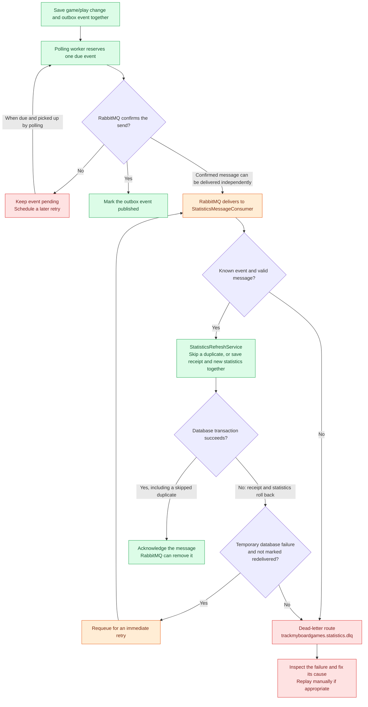
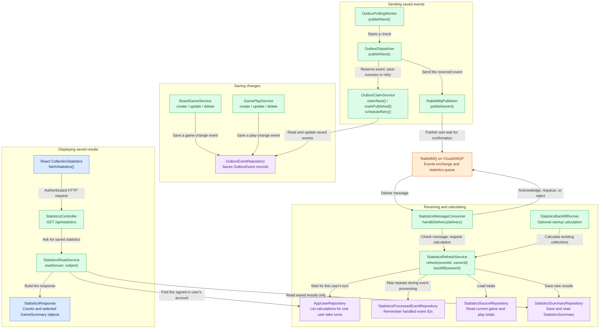

# Statistics Component - Event-Driven Architecture

**Current implementation:** PostgreSQL outbox, RabbitMQ hosted by CloudAMQP, and the existing Spring Boot backend. No separate statistics application is required.

Saving a game or play updates the user's records immediately. A background process then calculates the statistics shown on the collection page.

## 1. The main building blocks

```mermaid
flowchart LR
    Save["Save a game or play change<br/>BoardGameService<br/>GamePlayService"]
    Outbox[("outbox_events<br/>Events waiting to be sent")]
    Sender["OutboxDispatcher<br/>and RabbitMqPublisher"]
    Queue["CloudAMQP RabbitMQ<br/>trackmyboardgames.statistics"]
    Receiver["StatisticsMessageConsumer<br/>and StatisticsRefreshService"]
    Result[("statistics_summaries<br/>Saved collection<br/>statistics")]

    Save -->|"Save the change and event together"| Outbox
    Outbox -->|"Pick up a pending event"| Sender
    Sender -->|"Send through the events exchange"| Queue
    Queue -->|"Deliver the message"| Receiver
    Receiver -->|"Recalculate and save"| Result

    classDef application fill:#dcfce7,stroke:#16a34a,color:#14532d
    classDef database fill:#f3e8ff,stroke:#9333ea,color:#581c87
    classDef messaging fill:#ffedd5,stroke:#ea580c,color:#7c2d12
    classDef result fill:#dbeafe,stroke:#2563eb,color:#172554

    class Save,Sender,Receiver application
    class Outbox database
    class Queue messaging
    class Result result
```

| Piece | Plain-English purpose | Name in the code or database |
| --- | --- | --- |
| Event | A note saying a game or play changed | `GameAdded`, `GameUpdated`, `GameDeleted`, `PlayRecorded`, `PlayUpdated`, `PlayDeleted` |
| Outbox | Keeps the note until the sender can deliver it | `OutboxEvent`, stored in `outbox_events` |
| Sender | Picks up saved notes and sends them to RabbitMQ | `OutboxPollingWorker`, `OutboxDispatcher`, `RabbitMqPublisher` |
| Exchange and queue | Route messages and hold them for the receiver | `trackmyboardgames.events` and `trackmyboardgames.statistics` |
| Receiver | Checks a message and requests a statistics calculation | `StatisticsMessageConsumer` |
| Calculator | Recounts the user's current games and plays | `StatisticsRefreshService` |
| Saved results | Holds the collection count, selected games, and monthly play counts | `StatisticsSummary`, stored in `statistics_summaries` |
| Receipt book | Remembers events already handled so repeats are skipped | `StatisticsProcessedEvent`, stored in `statistics_processed_events` |

The sender watches the **outbox**, not the games or play-history tables. Saving a change deliberately saves its event in the same database transaction: either both succeed or neither does.

The receiver recalculates from **current database records**, rather than adding counts from an old message. This handles edits, deletes, and messages that arrive late. Calculations for the same user take turns; different users do not share that user-specific lock.

## 2. Delivery, retries, and failures

### If sending fails

- The event stays in the outbox. Retry delays start at five seconds and grow to a maximum of five minutes.
- A retry delay is the earliest it becomes eligible; the polling worker must still pick it up.
- A reserved event has a 30-second lease. If the backend stops before finishing, an expired reservation can be picked up later.
- If RabbitMQ accepted a message but saving "published" fails, the message may be sent again. This is why the receiver remembers processed event IDs.

### If receiving or calculating fails

- RabbitMQ delivers one unfinished message at a time to this receiver. It does not wait for the publisher's polling timer.
- Invalid messages go to the dead-letter queue through `trackmyboardgames.events.dlx`, using the route `statistics.failed`.
- A temporary database failure on a message not marked redelivered is requeued immediately. A processing failure on a redelivered message, or another kind of processing failure, goes to the dead-letter queue.
- "Redelivered" is not an exact attempt count: it can also follow a lost connection. The retry rule is deliberately conservative.
- The receiver acknowledges only after the database transaction commits. If the acknowledgement is lost, RabbitMQ may deliver again; the saved receipt prevents repeating the calculation.
- Dead-letter messages are **not automatically replayed**. Check the cause before manually replaying them. A broker-side consumer cancellation requires checking the queue and restarting the receiver.

## 3. How the classes work together

This is a class communication map, not a full list of every field and method. Arrows point from the caller to the class it uses. The orange RabbitMQ box is an external service, not a Java class; its outgoing arrow represents message delivery rather than a direct Java method call.

**Colors:** green is application work, purple is database access, orange is messaging, and blue is the page or returned data. Repository boxes are Java classes/interfaces that access PostgreSQL, not separate services.

Reading statistics and calculating statistics are separate paths. Opening the page calls `StatisticsReadService`, not `StatisticsRefreshService`. The response travels back through the controller to React; those return arrows are omitted to keep the picture readable.

The backfill uses the same calculation and user lock, but does not record an event receipt. RabbitMQ connections and application setup classes are omitted; the retry and dead-letter decisions are shown in diagram 2.

## What the collection page reads

`CollectionStatistics` requests `GET /api/statistics` when the collection page opens. `StatisticsController` and `StatisticsReadService` return the signed-in user's saved answers; this request does not calculate statistics or send events.

The cards show:

- **Collection:** number of games.
- **Most Popular!:** the most-played game's title/edition and available cover.
- **Plays This Month!:** number of plays with a played-on date in the current UTC month.
- **Latest To The Table!:** the most recently played game's title/edition and available cover.

The two selected games are `GameSummary` objects. Covers come from the collection's already-loaded games, matched by game ID. Missing results are blank; a calculated count of zero displays as zero.

There is **no frontend timer, statistics refresh button, or live push update**. Refreshing the browser or leaving and returning reads the latest saved results.

## Starting data and current limits

- `StatisticsBackfillRunner` calculates starting results for existing collections without sending messages. Enable `STATISTICS_BACKFILL_ENABLED=true` for the intended development database, then disable it after successful startup. Leaving it enabled repeats the job at every restart.
- RabbitMQ publishing is enabled with `RABBITMQ_ENABLED`; receiving is enabled separately with `RABBITMQ_CONSUMER_ENABLED`. Keep credentials in private settings, not tracked documentation.
- The publisher currently handles **one event per polling check**, with a default interval of 60 seconds (`RABBITMQ_POLL_INTERVAL_MS`). Batching is not implemented yet.
- Publishing and receiving run inside the same Spring Boot application, with separate RabbitMQ connections. The backend can run locally while connecting to a development CloudAMQP broker over the internet.

See the [root README](../../README.md) for setup and test details. The [deprecated SQS building blocks](deprecated/SQS-EDA-BUILDING-BLOCKS.md) preserve the earlier proposal; they do not describe the running solution.
