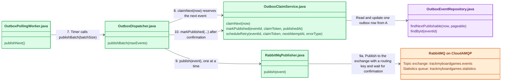

# Statistics Component - Event-Driven Architecture

**Current implementation:** PostgreSQL outbox, RabbitMQ hosted by CloudAMQP, and the existing Spring Boot backend.

Saving a game or play updates the user's records immediately. A background process then calculates the statistics shown on the collection page.

## 1. The main building blocks

```mermaid
flowchart LR
    Save["Save a game or play change<br/>BoardGameService<br/>GamePlayService"]
    Outbox[("outbox_events<br/>Events waiting to be sent")]
    Sender["OutboxDispatcher<br/>and RabbitMqPublisher"]
    Queue["CloudAMQP RabbitMQ<br/>trackmyboardgames.statistics"]
    Receiver["StatisticsMessageConsumer<br/>and StatisticsRefreshService"]
    Result[("statistics_summaries<br/>Saved collection<br/>statistics")]

    Save -->|"Save the change and event together"| Outbox
    Outbox -->|"Pick up a pending event"| Sender
    Sender -->|"Send through the events exchange"| Queue
    Queue -->|"Deliver the message"| Receiver
    Receiver -->|"Recalculate and save"| Result

    classDef application fill:#dcfce7,stroke:#16a34a,color:#14532d
    classDef database fill:#f3e8ff,stroke:#9333ea,color:#581c87
    classDef messaging fill:#ffedd5,stroke:#ea580c,color:#7c2d12
    classDef result fill:#dbeafe,stroke:#2563eb,color:#172554

    class Save,Sender,Receiver application
    class Outbox database
    class Queue messaging
    class Result result
```

## Flow diagram

Follow the panels from top to bottom. Each panel starts a new row of the same story, keeping the class boxes readable instead of extending one very wide diagram. Repeated repository and RabbitMQ boxes are connection points between panels.

### A. Save the game and its event

```mermaid
classDiagram
    direction LR
    class Phone["📱 User"] {
        Adds or edits a game
        Presses Save
    }
    class Form["BoardGameForm.tsx"] {
        handleSubmit(event)
    }
    class Page["CollectionPage.tsx"] {
        handleSubmit(values, coverImage)
    }
    class Controller["BoardGameController.java"] {
        create(jwt, request)
        update(jwt, gameId, request)
    }
    class Service["BoardGameService.java"] {
        create(subjectIssuer, subject, request)
        update(subjectIssuer, subject, gameId, request)
        saveGame(game)
        saveGameEvent(eventType, ownerId, game, occurredAt)
    }
    class Games["BoardGameRepository.java"] {
        saveAndFlush(game)
    }
    class Outbox["OutboxEventRepository.java"] {
        save(event)
    }

    Phone --> Form : 1. Submit the form
    Form --> Page : 2. Call the parent's onSubmit callback
    Page --> Controller : 3. Call to Backend Java. HTTP POST for create or PUT for update
    Controller --> Service : 4. Call create(...) or update(...)
    Service --> Games : 5. saveGame calls saveAndFlush(game)
    Service --> Outbox : 6. saveGameEvent calls save(event)

    style Phone fill:#dbeafe,stroke:#2563eb,color:#172554
    style Form fill:#dbeafe,stroke:#2563eb,color:#172554
    style Page fill:#dbeafe,stroke:#2563eb,color:#172554
    style Controller fill:#dcfce7,stroke:#16a34a,color:#14532d
    style Service fill:#dcfce7,stroke:#16a34a,color:#14532d
    style Games fill:#f3e8ff,stroke:#9333ea,color:#581c87
    style Outbox fill:#f3e8ff,stroke:#9333ea,color:#581c87
```

Blue represents the user's browser; green represents backend code. Purple boxes are repository interfaces that access PostgreSQL. Their save methods are supplied by Spring Data JPA, so you will not find those method implementations written in the repository files. RabbitMQ is not called during these saves; the polling worker picks up the committed outbox event separately.

After the service transaction commits and changes are saved into the database tables, this HTTP response does **not** wait for RabbitMQ.

### B. Pick up the saved event and publish it

**Continues from A:** the event is now committed in `outbox_events` database table. A timer starts this next path.

The default timer checks once a minute and attempts up to 10 events per check
(`RABBITMQ_BATCH_SIZE`), one at a time. Steps 8–10 repeat for each event, and the
worker claims each event immediately before sending it. A database lock is not
held while waiting for RabbitMQ. Confirmation means RabbitMQ accepted that
message, not that statistics finished updating. If sending fails,
`scheduleRetry(...)` leaves that event eligible for a later attempt instead of
marking it published; the batch can then continue with another due event.

Automatic publishing stops after **five total attempts**, including the initial
attempt. An unpublished row with `attempt_count >= 5` is treated as parked and
excluded from further claims. It stays in `outbox_events` with its last recorded
error for investigation; it is not sent to the consumer's dead-letter queue.
Attempts are counted when claimed, so a worker crash can also use an attempt.
There is no separate failed/parked column or automatic replay of exhausted events.

### C. Receive the message and save new statistics

**Continues from B:** RabbitMQ delivers the message independently. Delivery can happen before the sender finishes recording `published_at`; it does not wait for another polling check.

```mermaid
classDiagram
    direction LR
    class Broker["RabbitMQ on CloudAMQP"] {
        trackmyboardgames.statistics
    }
    class Consumer["StatisticsMessageConsumer.java"] {
        handleDelivery(delivery)
    }
    class Refresh["StatisticsRefreshService.java"] {
        refresh(eventId, ownerId)
        rebuildSummary(ownerId, now)
    }
    class Receipts["StatisticsProcessedEventRepository.java"] {
        recordIfNew(eventId, processedAt)
    }
    class Source["StatisticsSourceRepository.java"] {
        findGameTotals(ownerId)
        findMonthlyTotals(ownerId)
    }
    class Summaries["StatisticsSummaryRepository.java"] {
        saveAndFlush(summary)
    }

    Broker --> Consumer : 11. Deliver to consumer
    Consumer --> Refresh : 12. Validate message then call refresh(...)
    Refresh --> Receipts : 13. recordIfNew(...) skips repeated events
    Refresh --> Source : 14. Read current game and play totals
    Refresh --> Summaries : 15. rebuildSummary calls saveAndFlush(...)
    Consumer --> Broker : 16. Ack after commit

    class ReceiptRole["Have we handled this event already?"] {
        Store receipts in statistics_processed_events
        Do not read outbox_events
    }
    class SourceRole["What are the current game and play totals?"] {
        Read original game and play records
        Supply totals for the calculations
    }
    class SummaryRole["Save or retrieve the calculated answers"] {
        Store results in statistics_summaries
        Supply saved answers to the statistics API
    }
    Receipts ..> ReceiptRole : Responsibility
    Source ..> SourceRole : Responsibility
    Summaries ..> SummaryRole : Responsibility

    style Broker fill:#ffedd5,stroke:#ea580c,color:#7c2d12
    style Consumer fill:#dcfce7,stroke:#16a34a,color:#14532d
    style Refresh fill:#dcfce7,stroke:#16a34a,color:#14532d
    style Receipts fill:#f3e8ff,stroke:#9333ea,color:#581c87
    style Source fill:#f3e8ff,stroke:#9333ea,color:#581c87
    style Summaries fill:#f3e8ff,stroke:#9333ea,color:#581c87
    style ReceiptRole fill:#dbeafe,stroke:#2563eb,color:#172554
    style SourceRole fill:#dbeafe,stroke:#2563eb,color:#172554
    style SummaryRole fill:#dbeafe,stroke:#2563eb,color:#172554
```

The blue responsibility boxes explain the repositories; their dashed arrows are not additional processing steps.

`refresh(...)` first waits for any other calculation for the same user to finish,
using `AppUserRepository.findForStatisticsRefresh(...)` (omitted from the picture).
A repeated event skips the calculation and is acknowledged.

For a new event, the service writes a processing receipt to
`statistics_processed_events` and saves the owner's newly calculated results
(collection size, most-played game, most recently played game, and monthly play
counts) to `statistics_summaries`. Both database writes belong to one transaction.
Committing means making both writes permanent together; if the transaction fails,
neither write is kept. The receiver requeues or dead-letters failed messages.

### D. Read the saved statistics back into the page

**Continues from C through saved data, not a push notification:** the user refreshes the browser or leaves and returns to the collection page. There is no automatic statistics request after saving a game. If this read happens before C finishes, the page gets the previously saved results.

```mermaid
classDiagram
    direction LR
    class UI["CollectionStatistics.tsx"] {
        loadStatistics()
        setState(loadedStatistics)
    }
    class API["statisticsApi.ts"] {
        fetchStatistics(accessToken, signal)
    }
    class Controller["StatisticsController.java"] {
        get(jwt)
    }
    class Read["StatisticsReadService.java"] {
        read(issuer, subject)
    }
    class Summaries["StatisticsSummaryRepository.java"] {
        findById(ownerId)
    }

    UI --> API : 17. Fetch statistics
    API --> Controller : 18. HTTP GET /api/statistics
    Controller --> Read : 19. read(issuer, subject)
    Read --> Summaries : 20. Find saved results
    Summaries ..> Read : Saved summary
    Read ..> Controller : Return StatisticsResponse
    Controller ..> API : Return JSON over HTTP
    API ..> UI : 21. Update cards

    style UI fill:#dbeafe,stroke:#2563eb,color:#172554
    style API fill:#dbeafe,stroke:#2563eb,color:#172554
    style Controller fill:#dcfce7,stroke:#16a34a,color:#14532d
    style Read fill:#dcfce7,stroke:#16a34a,color:#14532d
    style Summaries fill:#f3e8ff,stroke:#9333ea,color:#581c87
```

The dotted return arrows show data travelling back to React. `setState` is the React setter used inside the component, not a separate API method. The read service finds the signed-in user's account before looking up its summary; it does not calculate statistics. Game covers come from the collection's separate game-list request.

For play sessions, the corresponding page is `PlayHistoryPage.tsx` and the backend entry point is `GamePlayController`, under `/api/games/{gameId}/plays`. Its service saves play-change events into the same outbox; panels B through D then follow the same background delivery and statistics-read path.

### Building-block reference

| Piece | Plain-English purpose | Name in the code or database |
| --- | --- | --- |
| Event | A note saying a game or play changed | `GameAdded`, `GameUpdated`, `GameDeleted`, `PlayRecorded`, `PlayUpdated`, `PlayDeleted` |
| Outbox | Keeps the note until the sender can deliver it | `OutboxEvent`, stored in `outbox_events` |
| Sender | Picks up saved notes and sends them to RabbitMQ | `OutboxPollingWorker`, `OutboxDispatcher`, `RabbitMqPublisher` |
| Exchange and queue | Route messages and hold them for the receiver | `trackmyboardgames.events` and `trackmyboardgames.statistics` |
| Receiver | Checks a message and requests a statistics calculation | `StatisticsMessageConsumer` |
| Calculator | Recounts the user's current games and plays | `StatisticsRefreshService` |
| Saved results | Holds the collection count, selected games, and monthly play counts | `StatisticsSummary`, stored in `statistics_summaries` |
| Receipt book | Remembers events already handled so repeats are skipped | `StatisticsProcessedEvent`, stored in `statistics_processed_events` |

The sender watches the **outbox**, not the games or play-history tables. Saving a change deliberately saves its event in the same database transaction: either both succeed or neither does.

The receiver recalculates from **current database records**, rather than adding counts from an old message. This handles edits, deletes, and messages that arrive late. Calculations for the same user take turns; different users do not share that user-specific lock.
