# General Statistics Request Flow

These diagrams follow a frontend request and its response. They do not show the
separate RabbitMQ workflow that rebuilds saved statistics after game/play changes.

## 1. General flow for current and future statistics

Statistics are calculated in PostgreSQL during background refreshes and saved
before the frontend asks for them. The request only reads and prepares saved
results. Different components can reuse data; not every component needs its own table.

```mermaid
flowchart LR
    UI["📱 React<br/>Statistics component X / Y / Z"]
    API["API endpoint<br/>StatisticsController"]
    Read["StatisticsReadService<br/>Request the signed-in user's saved results"]
    Saved["Repository<br/>Read precomputed statistics from the database"]
    Response["Read service builds a response object.<br/>with the values this request needs"]
    Return["API controller returns JSON"]
    Display["📱 React<br/>Populate cards or draw a graph"]

    UI -->|"HTTP GET"| API
    API -->|"Call the matching read method"| Read
    Read --> Saved
    Saved --> Response
    Response --> Return
    Return -->|"HTTP response"| Display

    classDef frontend fill:#dbeafe,stroke:#2563eb,color:#172554
    classDef application fill:#dcfce7,stroke:#16a34a,color:#14532d
    classDef saved fill:#f3e8ff,stroke:#9333ea,color:#581c87
    class UI,Display frontend
    class API,Read,Response,Return application
    class Saved saved
```

The read service may select a month or format the response, but it does not
recount games or plays. New statistics need their background database calculation
and storage implemented before the frontend can read their saved results.

## 2. Current CollectionStatistics request and response

This is the existing flow for the four collection-summary cards. The request
must be authenticated and have the `read:games` permission. The read service
finds the local owner using the validated token's issuer and subject before
requesting that owner's saved summary.

```mermaid
flowchart LR
    UI["📱 React: CollectionStatistics.tsx"]
    API["StatisticsController<br/>get"]
    Read["StatisticsReadService<br/>readCollectionStats"]
    Repo["StatisticsSummaryRepository<br/>findById using the owner ID"]
    DB[("Database: statistics_summaries<br/>Read the owner's saved row")]
    Model["CollectionStatisticsSummary<br/>Repository returns the row as a Java object"]
    Build["StatisticsReadService<br/>Copy the four values into<br/>CollectionStatisticsResponse"]
    Return["StatisticsController<br/>Return the response as JSON"]
    Cards["📱 React: populate the four cards<br/>Collection size / Most played<br/>Plays this month / Most recently played"]

    UI -->|"GET /api/statistics"| API
    API -->|"readCollectionStats"| Read
    Read -->|"Ask for this owner's summary"| Repo
    Repo -->|"Read saved results"| DB
    DB -->|"Map saved values"| Model
    Model -->|"Return to the read service"| Build
    Build --> Return
    Return -->|"HTTP response"| Cards

    classDef frontend fill:#dbeafe,stroke:#2563eb,color:#172554
    classDef application fill:#dcfce7,stroke:#16a34a,color:#14532d
    classDef persistence fill:#f3e8ff,stroke:#9333ea,color:#581c87
    classDef data fill:#ffedd5,stroke:#ea580c,color:#7c2d12
    class UI,Cards frontend
    class API,Read,Build,Return application
    class Repo,DB persistence
    class Model data
```

The response also includes the reporting month, timezone, and last refresh time.
If the owner or saved summary does not exist, the four card values are null,
not invented zero counts.

**No background recalculation is triggered by this GET request.** The
`StatisticsRefreshService` previously called `StatisticsRefreshQueryRepository`
to execute the `refresh_collection_statistics` database procedure. That procedure
calculated and saved the results. See the separate
[event-driven statistics flow](eda-architecture-statistics-component.md)
for that process.
