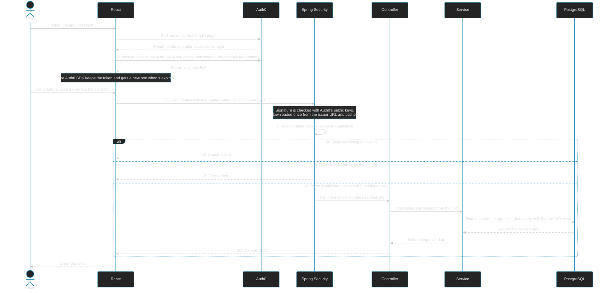

# How an Authenticated Request Is Handled

This document explains how Auth0, React and Spring Boot work together to authenticate a request. Auth0 issues a signed token (a JWT), React stores it and sends it with each API call, and Spring only verifies it. Spring never contacts Auth0 for each request.

## What Is Inside the JWT

| Claim | Meaning | Example |
|---|---|---|
| `sub` | The user's id | `auth0\|abc123` |
| `iss` | Who issued the token (the Auth0 tenant) | `https://your-tenant.us.auth0.com/` |
| `aud` | Which API the token is for | the API audience |
| `exp` | When the token expires | a timestamp |
| `scope` | The permissions granted | `read:games write:games` |

The token is signed, so React cannot change the `sub` or the scopes without breaking the signature.

## How This Shows Up in the Code

- **Scopes:** Auth0 decides which scopes go into the token. Spring enforces them. In `SecurityConfig`, `hasAuthority("SCOPE_read:games")` means "reject the request unless the token lists `read:games`". Spring adds the `SCOPE_` prefix itself.
- **`@AuthenticationPrincipal Jwt jwt`:** After Spring validates the token, it passes the decoded token to the controller method. The code reads `jwt.getSubject()` and `jwt.getIssuer()` to find or create the matching `AppUser`.
- **Owner filtering:** Each query is filtered by that owner's id, so another user's records look like 404 (not found).
- **Tests:** Tests use `jwt()` from Spring Security Test to fake an already validated token, so no real Auth0 call happens.
- **Frontend:** `apiHelpers.ts` holds the shared API audience and base URL, and each request attaches the token as a `Bearer` header.

## Security Notes

- The security lives in the backend checks: signature, scopes and the owner filter. Hiding a button in React is not security.
- Access tokens expire (often after 24 hours). The Auth0 SDK requests a new one when needed.
- See [board-game-create-flow.md](./board-game-create-flow.md) for a full example that continues past authentication into the service and database.
