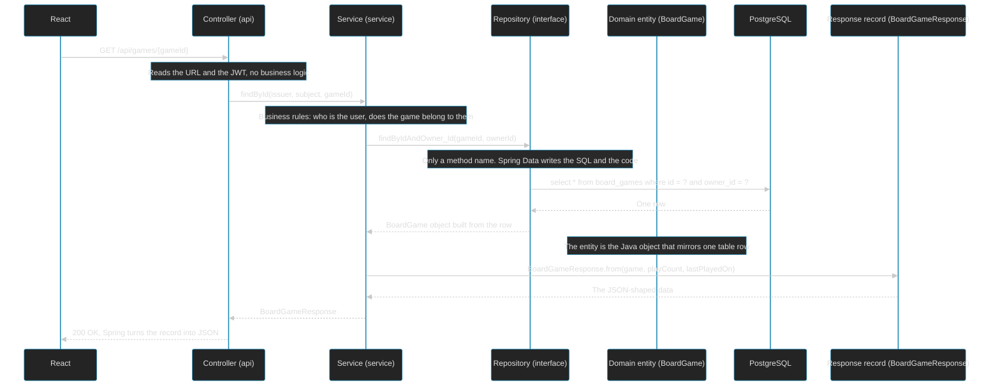
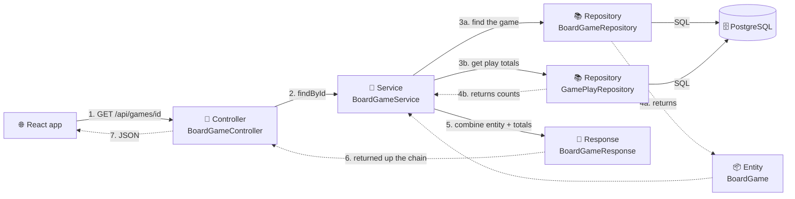

# How a Request Moves Through the Backend Layers

## High-Level View: The Usual Flow

```text
React sends an HTTP request
          ↓
Controller — Which API action was requested?
          ↓
Service — Is it allowed, and what needs to happen?
          ↓
Repository — Read or write the records.
          ↓
Database
```

## Detailed Request Example

This document shows what happens when React asks for one board game (`GET /api/games/{gameId}`), and what job each kind of file does. The QR label code follows the same pattern.



## High-Level View: Who Calls What

Solid arrows are calls. Dotted arrows are what comes back. The service is the only layer that talks to the repositories, and it builds the response.



## Where Does playCount Come From?

It isn't stored on the game. `BoardGameService` asks `GamePlayRepository` for the totals (a `count` and `max(played_on)` grouped by game) and passes the game plus those numbers to `BoardGameResponse.from(...)`. A game with no plays has no totals row, so the service treats it as 0.

## What Each File Type Does

| File type | Example | Job |
|---|---|---|
| Controller | `QrLabelController` | Receives the HTTP request, reads the URL, body and JWT, calls the service, returns the result. No rules. |
| Service | `QrLabelService` | The business logic: find the user, check ownership, create or change data, decide errors (404, 400). Marks the transaction boundary. |
| Repository | `QrLabelCodeRepository` | The database access. An interface only. Spring writes the implementation. |
| Domain (entity) | `QrLabelCode` | A Java class mapped to a table. One object is one row. It is the internal model. |
| Response / Request | `QrLabelResponse` | The shape of the JSON that goes out or comes in. It is separate from the entity on purpose. |

## Why a Separate Response File?

The entity is the database model. The response is the public contract with React.
- It controls which fields are exposed. For example, an entity might hold an owner object, which should never be sent out.
- It can contain data the table doesn't have, such as `playCount` or an image turned into a data URL.
- It avoids lazy-loading and circular-reference problems when Jackson (the JSON library) reads an entity.
- The database can change without breaking the frontend.

## Where Is the Repository Implementation?

There isn't one in the code. A repository extends `JpaRepository`, and when the app starts Spring Data builds the implementation for you. For a method like `findAllByOwner_IdOrderByCreatedAtDesc`, it reads the **method name** and generates the query.

| Part of the name | Meaning |
|---|---|
| `findAll` | Return a list |
| `By` | Start of the filter |
| `Owner_Id` | The `owner` field, then its `id` (the underscore marks the step into the related object) |
| `OrderBy` | Start of the sorting |
| `CreatedAt` | Sort by the `createdAt` field |
| `Desc` | Newest first |

The result is roughly `select * from qr_label_codes where owner_id = ? order by created_at desc`.

Long names like this are common and intended in Spring Data. When a name gets too long (many filters), the usual alternative is a `@Query` with the SQL or JPQL written out, as `GamePlayRepository` does for its totals.
